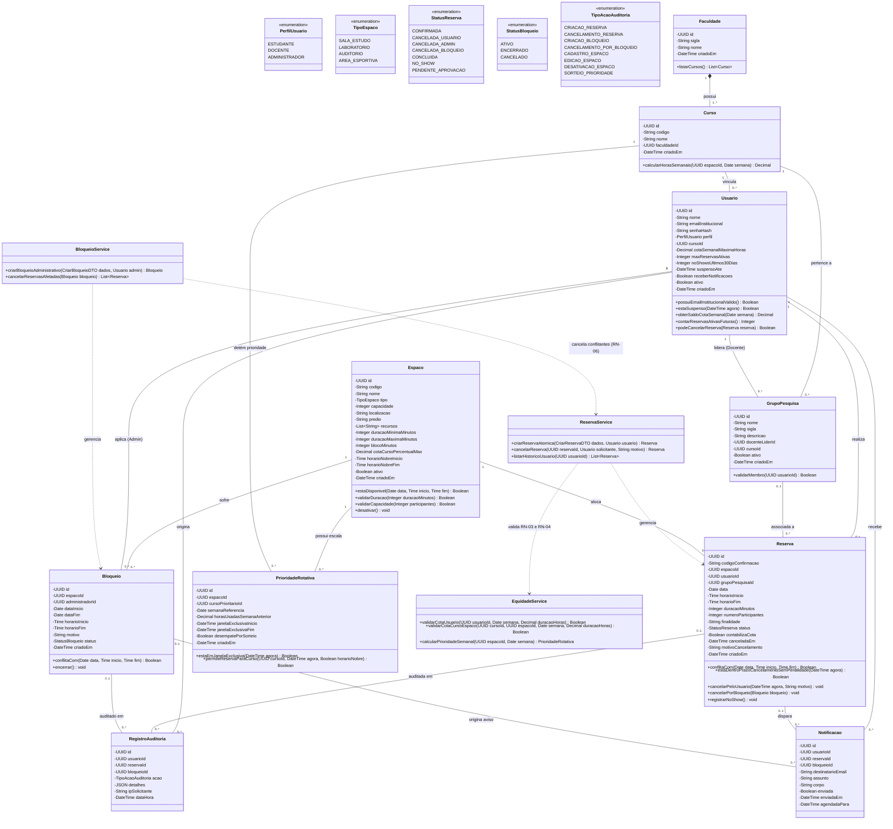

# Diagrama de Classes UML — UNISpace (T15)

---

## 1. Identificação e Metadados

| Atributo | Detalhe |
|---|---|
| **Tarefa / Issue** | **T15** — Diagrama de Classes UML ([#13](https://github.com/Gruner19/UNISpace/issues/13)) |
| **Responsável (Execução)** | Jordan Rivaldo Correa García (I3) |
| **Revisor Designado** | Ryan Alessandro Lazaro Urtecho (I4) |
| **Domínio Arquitetural** | Arquitetura de Dados e Backend (Modelagem Orientada a Objetos e Domínio) |
| **Dependências de Entrada** | T6 (`cu-reservar-ambiente.md`), T13 (`regras-de-negocio.md`, `glossario.md`), P0.1 (`adr-001-stack.md`), P0.5 (Regras decididas pelo PO) |
| **Tarefas Desbloqueadas** | **P0.4** (Modelo relacional e DDL do banco), **T6.1** (Restrições anti-sobreposição e auditoria), **T6.2** (API de reservas) |
| **Arquivos Entregues** | `docs/diagramas/diagrama-classes.puml` (PlantUML) e `docs/diagramas/diagrama-classes.md` |

---

## 2. Visão Geral da Arquitetura de Domínio

O modelo de classes do **UNISpace** foi projetado seguindo a arquitetura em camadas definida no **ADR-001** (Node.js + Express + Prisma ORM + PostgreSQL), dividindo-se em três núcleos coesos:

1. **Entidades de Domínio (`Models`):** Representam o estado persistente e as invariantes de negócio da plataforma (`Faculdade`, `Curso`, `Usuario`, `GrupoPesquisa`, `Espaco`, `Reserva`, `Bloqueio`, `PrioridadeRotativa`, `RegistroAuditoria` e `Notificacao`).
2. **Enumerações de Domínio (`Enums`):** Tipificam de maneira estrita os perfis de acesso (`PerfilUsuario`), categorias físicas com regras próprias de duração (`TipoEspaco`), ciclo de vida transacional (`StatusReserva`, `StatusBloqueio`) e eventos de rastreabilidade (`TipoAcaoAuditoria`).
3. **Camada de Serviços de Aplicação (`Application Services`):** Orquestra transações atômicas ACID (`ReservaService`), filtros de agenda (`DisponibilidadeService`), políticas de equidade (`EquidadeService`), bloqueios administrativos soberanos (`BloqueioService`), auditoria imutável (`AuditoriaService`) e inteligência analítica (`RelatorioService`).

---

## 3. Diagrama de Classes (Renderização Nativa Mermaid)

> A versão fonte em **PlantUML** encontra-se em [`docs/diagramas/diagrama-classes.puml`](./diagrama-classes.puml). Abaixo está a representação equivalente em **Mermaid** para visualização direta no GitHub:

---

## 4. Dicionário de Classes e Rastreabilidade com Regras de Negócio

### 4.1. `Usuario` e Estrutura Acadêmica (`Faculdade`, `Curso`, `GrupoPesquisa`)
- **Responsabilidade:** Representa qualquer membro autenticado da universidade (`ESTUDANTE`, `DOCENTE`, `ADMINISTRADOR`) e seu vínculo departamental para apuração de cotas individuais e coletivas.
- **Mapeamento de Regras de Negócio:**
  - **RN-02:** O atributo `emailInstitucional` é único e validado pelo método `possuiEmailInstitucionalValido()`.
  - **RN-03 (P0.5):** `cotaSemanalMaximaHoras` (padrão `6.0` horas/semana) e `maxReservasAtivas` (máximo `2` reservas futuras simultâneas). O vínculo com `Curso` e `Faculdade` permite apurar o teto de **40% das horas semanais do espaço por curso**.
  - **RN-05 (P0.5):** `noShowsUltimos30Dias` e `suspensoAte` controlam a suspensão automática de **7 dias** caso o usuário acumule **3 não comparecimentos (no-shows) em 30 dias**.
  - **RN-11:** O método `podeCancelarReserva()` garante que somente o titular da reserva ou um `ADMINISTRADOR` possa cancelá-la.
  - **HU-13:** `GrupoPesquisa` vincula um docente líder (`docenteLiderId`) e permite reservas institucionais para grupos de pesquisa.

### 4.2. `Espaco`
- **Responsabilidade:** Modela os ambientes físicos compartilhados da universidade (`SALA_ESTUDO`, `LABORATORIO`, `AUDITORIO`, `AREA_ESPORTIVA`).
- **Mapeamento de Regras de Negócio:**
  - **RN-08 (P0.5):** Parametriza por espaço a duração mínima (`duracaoMinimaMinutos`), máxima (`duracaoMaximaMinutos`) e tamanho de bloco (`blocoMinutos`):
    - *Salas de estudo:* 30 min a 120 min (blocos de 30 min).
    - *Laboratórios:* 30 min a 180 min (blocos de 30 min).
    - *Auditórios:* 60 min a 240 min (blocos de 60 min).
    - *Áreas esportivas:* 60 min a 120 min (blocos de 60 min).
  - **RN-09:** O atributo `capacidade` e o método `validarCapacidade(participantes)` impedem superlotação.
  - **RN-12:** O atributo booleano `ativo` (soft delete via `desativar()`) bloqueia novas reservas em espaços desativados sem apagar o histórico de `Reserva` e `RegistroAuditoria`.

### 4.3. `Reserva`
- **Responsabilidade:** Entidade transacional central que aloca um `Espaco` a um `Usuario` (e opcionalmente a um `GrupoPesquisa`) em uma `data` e intervalo `[horarioInicio, horarioFim)`.
- **Mapeamento de Regras de Negócio:**
  - **RN-01 & RN-10:** O método `conflitaCom(data, inicio, fim)` aplica a fórmula de interseção temporal $(S_1 < E_2 \land E_1 > S_2)$, reforçada no banco de dados por trava pessimista (`FOR UPDATE`) e restrição de exclusão (`EXCLUDE USING gist`).
  - **RN-03 & RN-05 (P0.5):** O atributo `contabilizaCota` permanece `true` quando a reserva está ativa/concluída ou quando é cancelada com **menos de 2 horas de antecedência** (`estaDentroPrazoCancelamentoSemPenalidade()`). Se cancelada com $\ge 2\text{h}$ de antecedência, `contabilizaCota` passa para `false`, devolvendo as horas ao saldo semanal do usuário.

### 4.4. `Bloqueio`
- **Responsabilidade:** Representa períodos de interdição administrativa por manutenção ou evento institucional.
- **Mapeamento de Regras de Negócio:**
  - **RN-06 & RN-07:** Possui precedência soberana sobre `Reserva`. Ao ser criado via `BloqueioService.criarBloqueioAdministrativo()`, todas as reservas confirmadas conflitantes no intervalo têm seu status alterado para `CANCELADA_BLOQUEIO` (liberando a cota dos usuários afetados) e disparam objetos `Notificacao`.

### 4.5. `PrioridadeRotativa`
- **Responsabilidade:** Materializa a regra de equidade entre cursos para cada espaço em uma semana de referência (`semanaReferencia`).
- **Mapeamento de Regras de Negócio:**
  - **RN-04 (P0.5):** Registra o `cursoPrioritarioId` (curso com menor uso de horas na semana anterior) e a janela exclusiva de 24 horas (`janelaExclusivaInicio` a `janelaExclusivaFim`) para reserva de horários nobres (`horarioNobreInicio` a `horarioNobreFim`). Em caso de empate na semana anterior, `desempatePorSorteio = true` é auditado em `RegistroAuditoria`.

### 4.6. `RegistroAuditoria` e `Notificacao`
- **Responsabilidade:**
  - `RegistroAuditoria` (**RN-13**): Log append-only imutável que grava quem (`usuarioId`), quando (`dataHora`), de onde (`ipSolicitante`) e qual operação crítica (`TipoAcaoAuditoria`) foi executada sobre reservas, bloqueios, espaços ou sorteios de equidade.
  - `Notificacao` (**HU-11 / RN-07**): Representa os avisos enviados por e-mail institucional na confirmação de reserva, lembrete de proximidade ou cancelamento por bloqueio administrativo.

---

## 5. Diretrizes Diretas para o Modelo Relacional (Desbloqueio de P0.4 e T6.1)

Para manter rastreabilidade 1:1 com a tarefa **P0.4** (Modelo de Banco de Dados) e **T6.1** (Restrição anti-sobreposição e auditoria):

1. **Tabelas Principais:** `faculdades`, `cursos`, `usuarios`, `grupos_pesquisa`, `espacos`, `reservas`, `bloqueios`, `prioridades_rotativas`, `registros_auditoria`, `notificacoes`.
2. **Índices e Constraints Críticas (PostgreSQL):**
   - `usuarios.email_institucional`: `UNIQUE NOT NULL`.
   - `reservas`: Restrição `CHECK (horario_inicio < horario_fim)` e `CHECK (numero_participantes >= 1)`.
   - **Anti-sobreposição no PostgreSQL (T6.1):** Extensão `btree_gist` com constraint de exclusão em `reservas` onde `status = 'CONFIRMADA'`, garantindo a impossibilidade física de duas reservas simultâneas para o mesmo `espaco_id` e `data` com interseção de horário (`RN-01`, `RN-10`).
